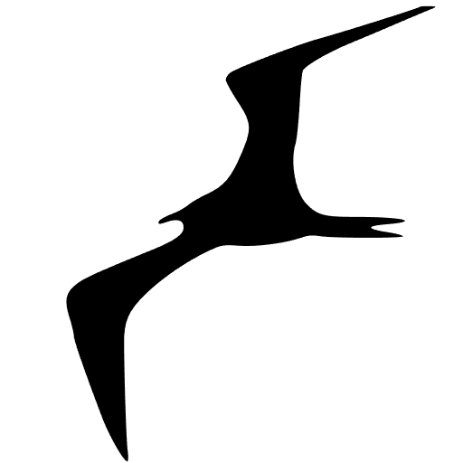

# ioBroker.frigate

**Tests:** 

> [!IMPORTANT]
> This adapter cannot be installed from github

**This adapter uses Sentry libraries to automatically report exceptions and code errors to the developers.** For more details and for information on how to disable the error reporting, see [Sentry-Plugin Documentation](https://github.com/ioBroker/plugin-sentry#plugin-sentry)! Sentry reporting is used starting with js-controller 3.0.

## frigate adapter for ioBroker

Adapter for [Frigate NVR](https://frigate.video/) — an open-source, self-hosted video surveillance system with AI-powered object detection.

## Documentation

[🇺🇸 Documentation](./docs/en/README.md)

[🇩🇪 Dokumentation](./docs/de/README.md)

## Discussion and questions

[https://forum.iobroker.net/topic/64928/frigate-adapter-für-iobroker](https://forum.iobroker.net/topic/64928/frigate-adapter-für-iobroker)

## Changelog

<!--
    Placeholder for the next version (at the beginning of the line):
  ### **WORK IN PROGRESS**
-->
### 3.2.5 (2026-11-06)
- (@GermanBluefox) The event history showed values of older events: the entries are numbered by position, and a field the new event at a position does not have (e.g. `sub_label` without a recognized name, a zone it did not enter) kept the value of the event that was there before. When Frigate returned fewer events than before (e.g. after its retention period), the positions beyond kept the old events. Such values are now set to `null`, also the ones left from before an update of the adapter

### 3.2.4 (2026-11-06)
- (@GermanBluefox) The event history (`events.history.*`, `<camera>.history.*`, `events.history.json`) is fetched again after every event, and nearly all of it was written again unchanged - several thousand writes within seconds, which every adapter subscribed to all states (e.g. MQTT with `*`, JavaScript) had to process as well. Now only values that changed are written, also after a restart. After an event only the overall history and the history of that camera are fetched, no longer those of all cameras. Live values from MQTT are written as before

### 3.2.3 (2026-11-05)
- (@GermanBluefox) ioBroker.web can stop the web extension and start it again with new settings instead of restarting itself (`supportsHotReload`, with a version of web that supports it). When it is stopped, the web extension now also ends the MJPEG streams to the browsers

### 3.2.2 (2026-10-07)
- (@GermanBluefox) Added a link to the web interface of Frigate, on the instance in admin and as a card on the intro page. It points at the address the adapter itself talks to (`friurl`); with the default `localhost:5000`, admin 8.0.24 and newer open it on the host the instance runs on instead of on the machine of the browser. With Frigate in a container of the adapter, the link follows the stored address and not the port of the container, where the two differ

### 3.2.1 (2026-09-28)
- (@GermanBluefox) In broker mode the adapter reports the port of its built-in MQTT broker to js-controller 8, which keeps a per-host registry of the occupied ports (`system.host.<name>.usedResources`). The default 1883 is also the default of the MQTT adapter, so the log now names the instance that already declared the port instead of only reporting "port is already in use". The port is taken from the running server and given back when it closes. In client mode nothing is reported: the broker is on another machine. An older js-controller is unaffected
- (@GermanBluefox) The fullscreen dialog of the camera widgets for `ioBroker.devices` opened as a bare strip with some cameras: the dialog takes its height from the picture in it, and a picture that has not arrived yet is zero pixels high. The dialog now keeps a place for it and shows that it is on its way. The live widget also stops the stream of the tile for as long as the dialog is open - a browser grants about six connections per server, every camera tile holds one of them for as long as its stream runs, and the stream of the dialog was therefore the one that never got a turn. A stream that still brings no frame within ten seconds is given up on, and the pictures come over the socket instead, as they already did when a stream reported an error

[Older changelogs can be found there](CHANGELOG_OLD.md)

## License

MIT License

Copyright (c) 2026 iobroker-community-adapters <iobroker-community-adapters@gmx.de>  
Copyright (c) 2024-2025 TA2k <tombox2020@gmail.com>

Permission is hereby granted, free of charge, to any person obtaining a copy
of this software and associated documentation files (the "Software"), to deal
in the Software without restriction, including without limitation the rights
to use, copy, modify, merge, publish, distribute, sublicense, and/or sell
copies of the Software, and to permit persons to whom the Software is
furnished to do so, subject to the following conditions:

The above copyright notice and this permission notice shall be included in all
copies or substantial portions of the Software.

THE SOFTWARE IS PROVIDED "AS IS", WITHOUT WARRANTY OF ANY KIND, EXPRESS OR
IMPLIED, INCLUDING BUT NOT LIMITED TO THE WARRANTIES OF MERCHANTABILITY,
FITNESS FOR A PARTICULAR PURPOSE AND NONINFRINGEMENT. IN NO EVENT SHALL THE
AUTHORS OR COPYRIGHT HOLDERS BE LIABLE FOR ANY CLAIM, DAMAGES OR OTHER
LIABILITY, WHETHER IN AN ACTION OF CONTRACT, TORT OR OTHERWISE, ARISING FROM,
OUT OF OR IN CONNECTION WITH THE SOFTWARE OR THE USE OR OTHER DEALINGS IN THE
SOFTWARE.
